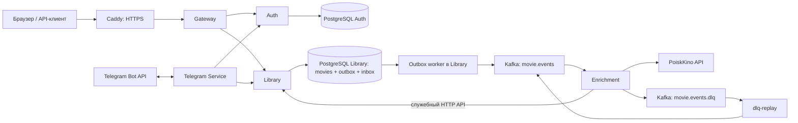

# MovieTracker

[](https://github.com/GrimVeqsum/MovieTracker/actions/workflows/ci.yml)

MovieTracker — микросервисный Go backend для личной библиотеки фильмов. Пользователь добавляет фильмы, отмечает просмотр, сохраняет оценку и отзыв, получает случайный непросмотренный фильм. Метаданные загружаются асинхронно; библиотекой также можно управлять через веб-интерфейс Gateway и Telegram-бота.

Инженерный аудит, приоритеты дефектов, исправления и границы проверенных гарантий: [docs/AUDIT.md](docs/AUDIT.md).

## Архитектура



| Компонент | Ответственность |
| --- | --- |
| Gateway | Веб-интерфейс, reverse proxy `/auth/*` и `/movies*`, ограничения частоты запросов, проверка доверия к прокси |
| Auth | Регистрация, bcrypt, JWT, ротация и отзыв refresh-сессий, привязка Telegram |
| Library | Изоляция фильмов по пользователю, просмотр/оценки/отзывы, soft delete, transactional outbox, идемпотентное применение metadata |
| Enrichment | Kafka consumer, PoiskKino, повторные попытки, отправка результата в Library, DLQ |
| Telegram | Long polling Telegram Bot API, команды библиотеки, получение короткого пользовательского JWT через служебный API Auth |

Auth и Library владеют отдельными базами и миграциями. Общих транзакций между сервисами нет. Outbox worker работает в процессе Library; отдельного сервиса для публикации нет. Внутренние маршруты `/internal/*` защищены отдельными service tokens и не проксируются Gateway.

Стек: Go 1.25.5+, `net/http`, pgx, PostgreSQL 18, franz-go, Kafka в KRaft-режиме, golang-migrate, JWT HS256, Docker Compose, Caddy, GitHub Actions.

## Локальный запуск

Нужны Docker Engine, Docker Compose v2; для запуска Go-проверок — Go с поддержкой версии из `go.mod`. Примеры API ниже используют `curl` и `jq`.

### Секреты

Создайте `.secrets/` и заполните файлы:

| Файл | Значение |
| --- | --- |
| `auth_db_password` | Пароль PostgreSQL Auth |
| `library_db_password` | Пароль PostgreSQL Library |
| `jwt_secret` | Общий ключ Auth/Library, минимум 32 символа; используйте случайный ключ |
| `telegram_bot_token` | Токен бота Telegram |
| `telegram_auth_service_token` | Общий секрет Telegram → Auth |
| `movie_api_key` | Ключ PoiskKino |
| `enrichment_library_service_token` | Общий секрет Enrichment → Library |

Для локальных ключей и паролей подходит `openssl rand -hex 32`; токены внешних API нужно получить у соответствующих провайдеров. Файл содержит только значение: без кавычек и пробелов в начале/конце; завершающий перевод строки допустим. Пароли с символами `@`, `:`, `/`, `%` поддерживаются: миграции кодируют пароль в URL.

```bash
mkdir -p .secrets
chmod 700 .secrets
# Заполните все семь файлов, затем:
chmod 644 .secrets/*
```

В обычном Docker Compose file secrets монтируются как bind mounts: `uid`/`mode` в декларации секрета не меняют права исходного файла. Go-контейнеры работают под UID 10001 и должны читать файл с правами `0644`; родительский каталог `0700` закрывает доступ другим пользователям хоста. `deploy/deploy.sh` выставляет эти права. `.secrets/` и `.env` исключены из Git. Production credentials не нужны для тестов.

### Compose

```bash
docker compose -f docker-compose.yml -f docker-compose.dev.yml config --quiet
docker compose -f docker-compose.yml -f docker-compose.dev.yml up -d --build
docker compose -f docker-compose.yml -f docker-compose.dev.yml ps
curl -fsS http://localhost:8080/ready
```

Миграции запускаются перед приложениями; Kafka topics создаёт `kafka-init`. Полный пользовательский сценарий с Telegram и обогащением требует действующих внешних токенов.

Все dev-порты привязаны к loopback:

| Адрес хоста | Назначение |
| --- | --- |
| `http://localhost:8080` | Gateway и веб-интерфейс |
| `http://localhost:8081/swagger/index.html` | Swagger Library |
| `http://localhost:8082/swagger/index.html` | Swagger Auth |
| `localhost:5433` | PostgreSQL Library |
| `localhost:5434` | PostgreSQL Auth |
| `localhost:9092` | Kafka с внешним advertised listener для клиентов хоста |

Dev Compose сохраняет внутренний Kafka listener `kafka:19092` для сервисов и добавляет внешний `localhost:9092` для клиентов хоста. Production listener остаётся внутри Docker-сети.

Браузерный origin по умолчанию — `http://localhost:8080`. Для другого адреса задайте `MOVIETRACKER_PUBLIC_ORIGIN`, например `http://127.0.0.1:8080`, перед запуском Compose. Dev Gateway не доверяет входящим `X-Forwarded-*`; IP берётся из TCP-соединения.

```bash
docker compose -f docker-compose.yml -f docker-compose.dev.yml logs -f library-app enrichment-app
# Остановить, сохранив данные:
docker compose -f docker-compose.yml -f docker-compose.dev.yml down
```

Обычная остановка и deploy не удаляют volumes. Для сброса тестовых данных используйте отдельный интеграционный runner ниже.

## HTTP API

Через Gateway доступны следующие операции:

| Метод и путь | Действие |
| --- | --- |
| `POST /auth/register` | Регистрация: `email`, `password` |
| `POST /auth/login` | JWT в JSON и refresh token в cookie |
| `POST /auth/refresh` | Ротация refresh cookie и новый JWT |
| `POST /auth/logout` | Отзыв refresh-сессии и удаление cookie |
| `POST /auth/telegram/link-code` | Одноразовый код привязки, нужен Bearer JWT |
| `POST /movies` | Добавить фильм: `title`, необязательный `release_year` |
| `GET /movies` | Все активные фильмы пользователя |
| `GET /movies/random` | Случайный непросмотренный фильм |
| `GET /movies/{id}` | Один фильм |
| `PATCH /movies/{id}/watched` | Просмотр: `rating` 1–10, необязательный `review` |
| `PATCH /movies/{id}/unwatched` | Снять просмотр, очистить оценку и отзыв |
| `DELETE /movies/{id}` | Soft delete |
| `GET /health`, `GET /ready` | Жив ли процесс / готов ли обслуживать запросы |

Все операции с фильмами требуют `Authorization: Bearer <access_token>`. ID — UUID. Чужой и отсутствующий фильм дают `404`; повтор активного фильма с тем же нормализованным названием и годом — `409`. После soft delete фильм можно добавить заново. Название ограничено 300 символами, отзыв — 5000, публичный JSON Auth/Library — 64 КиБ. Ошибки имеют форму `{"error":{"code":"...","message":"..."}}`.

Пример полного сеанса:

```bash
BASE_URL=http://localhost:8080
umask 077
COOKIE_JAR=$(mktemp)

curl -fsS -X POST "$BASE_URL/auth/register" \
  -H 'Content-Type: application/json' \
  -d '{"email":"demo@example.com","password":"portfolio-demo-password"}'

TOKEN=$(curl -fsS -c "$COOKIE_JAR" -X POST "$BASE_URL/auth/login" \
  -H 'Content-Type: application/json' \
  -d '{"email":"demo@example.com","password":"portfolio-demo-password"}' \
  | jq -r '.access_token')

MOVIE_ID=$(curl -fsS -X POST "$BASE_URL/movies" \
  -H "Authorization: Bearer $TOKEN" -H 'Content-Type: application/json' \
  -d '{"title":"Inception","release_year":2010}' | jq -r '.id')

curl -fsS "$BASE_URL/movies" -H "Authorization: Bearer $TOKEN"
curl -fsS "$BASE_URL/movies/random" -H "Authorization: Bearer $TOKEN"
curl -fsS -X PATCH "$BASE_URL/movies/$MOVIE_ID/watched" \
  -H "Authorization: Bearer $TOKEN" -H 'Content-Type: application/json' \
  -d '{"rating":9,"review":"Хочется пересмотреть"}'
curl -fsS -X PATCH "$BASE_URL/movies/$MOVIE_ID/unwatched" \
  -H "Authorization: Bearer $TOKEN"

TOKEN=$(curl -fsS -b "$COOKIE_JAR" -c "$COOKIE_JAR" \
  -X POST "$BASE_URL/auth/refresh" | jq -r '.access_token')

curl -fsS -X DELETE "$BASE_URL/movies/$MOVIE_ID" \
  -H "Authorization: Bearer $TOKEN"
curl -fsS -b "$COOKIE_JAR" -c "$COOKIE_JAR" -X POST "$BASE_URL/auth/logout"
rm -f "$COOKIE_JAR"
```

Refresh cookie: host-only, `HttpOnly`, `SameSite=Lax`, `Path=/auth`, в production — `Secure`. JWT живёт 15 минут, refresh-сессия — до 30 дней с момента входа, без продления срока при ротации. Из конкурентных refresh одного токена успешен один; поздний `401` не стирает новую cookie. Logout по любому ранее выданному токену сессии отзывает её, включая гонку с refresh. Access JWT продолжает действовать до истечения срока (+30 секунд допустимой погрешности часов).

Auth проверяет browser `Origin` для login/refresh/logout и использует Fetch Metadata. В Compose `AUTH_PUBLIC_ORIGIN` задаётся из публичного адреса; пользовательские forwarded headers не определяют разрешённый origin. CLI без browser headers поддерживается. Не храните access tokens и cookie jar в Git или логах.

Gateway ограничивает запросы с одного IP: login — 5/мин, register — 3/мин, refresh — 30/мин, создание Telegram-кода — 10/мин. Превышение даёт `429` и `Retry-After`.

## Telegram

Получите код из веб-интерфейса или API:

```bash
curl -fsS -X POST "$BASE_URL/auth/telegram/link-code" \
  -H "Authorization: Bearer $TOKEN"
```

Отправьте боту `/link CODE` в течение 10 минут. Код одноразовый. Для собственного бота поменяйте `TELEGRAM_BOT_USERNAME` у Gateway в Compose вместе с токеном Telegram Service.

Команды:

```text
/add Интерстеллар
/add Интерстеллар | 2014
/movies
/random
/watched 1 9
/watched 1 9 | Отличный фильм
/unwatched 1
/delete 1
/link CODE
/help
/status
```

`N` в командах — номер из актуального `/movies`, а HTTP API использует UUID. Telegram обращается к Auth/Library по внутренней сети; пользовательский JWT выдаётся для привязанного Telegram ID. В тестах Bot API заменяется локальным HTTP-сервером.

## Transactional outbox, Kafka и inbox

1. Создание фильма, изменение просмотра и soft delete записывают изменение и событие в `outbox_events` **одной PostgreSQL-транзакцией**. При ошибке outbox изменение откатывается. Ответ HTTP означает commit в БД, а не завершённое обогащение.
2. Worker забирает событие через `FOR UPDATE SKIP LOCKED`, выдаёт lease на минуту и публикует в `movie.events` с ключом `movie_id`. Lease берётся непосредственно перед каждой публикацией. `published_at` появляется после Kafka ACK; ошибка оставляет событие для retry с задержкой до минуты.
3. Между Kafka ACK и записью `published_at` возможен сбой: событие будет отправлено повторно после освобождения lease. Гарантия — **at-least-once**, общей транзакции PostgreSQL/Kafka нет.
4. Enrichment обогащает `MovieCreated`; остальные существующие события библиотеки не требуют вызова PoiskKino. Consumer отключает auto-commit и подтверждает offset после принятого Library результата либо подтверждённой записи в DLQ. Неудача обработки/commit не позволяет перейти к более высокому offset и пропустить неразрешённое сообщение.
5. Library атомарно сохраняет metadata, жанры и inbox-marker в `processed_events` с уникальным `(consumer, event_id)`. Повтор успешного события не меняет результат. Статус `failed` не занимает marker успешной обработки: replay того же `event_id` может перевести фильм в `ready`. Поздняя ошибка не откатывает `ready` обратно в `failed`.

Пользовательские оценка, отзыв и статус просмотра не заменяются metadata. Явно заданный пользователем год сохраняется; при конфликте уникальности заполнение отсутствующего года пропускается, остальные metadata применяются. Проверяются и `movie_id`, и `user_id`.

Временные ошибки внешнего API/Library повторяются до пяти попыток с задержками 2/4/8/16 секунд. Невосстановимые ошибки сообщения/служебного запроса и исчерпанные попытки отправляются в `movie.events.dlq`; выставление `metadata_status=failed` при этом выполняется best effort. Отсутствие фильма в поисковой выдаче PoiskKino — отдельный конечный результат `failed`, без автоматической DLQ. Если сама DLQ недоступна, исходный offset не подтверждается. После завершения лимита времени обработки consumer завершает работу с ошибкой, Compose перезапускает его для повторного чтения.

### DLQ и replay

DLQ хранит исходные key/value в Base64, source topic/partition/offset, число попыток, время и причину ошибки. Сначала устраните причину: ключ API, доступность Library, неверную конфигурацию или ошибку обработчика.

Обычный replay возобновляется по offsets группы `movie-enrichment-dlq-replay`:

```bash
docker compose -f docker-compose.yml -f docker-compose.prod.yml \
  run --rm --no-deps --entrypoint /app/dlq-replay enrichment-app \
  -limit 10 -idle-timeout 10s
```

Публикация в основной topic происходит до commit DLQ offset. Сбой между ними означает повтор; Library подавляет повторное применение. Внутри одного запуска одинаковый `event_id` публикуется один раз, подтверждённые дубликаты в DLQ пропускаются. Новая группа через `-group NAME` позволяет заново пройти retained-сообщения.

Точечный replay:

```bash
docker compose -f docker-compose.yml -f docker-compose.prod.yml \
  run --rm --no-deps --entrypoint /app/dlq-replay enrichment-app \
  -event-id '<event_uuid>' -idle-timeout 10s
```

С `-event-id` выполняется независимое чтение с начала retained DLQ **без consumer group и commit offsets**. Чужие события не исчезают из очереди обычного replay; выбранное событие может впоследствии попасть и в обычный replay, что безопасно для идемпотентного результата. `-group` в этом режиме не определяет позицию чтения. Повреждённая DLQ-запись останавливает replay без подтверждения; её нужно исследовать вручную. `-idle-timeout` ограничивает ожидание следующей записи, `-limit` — число уникальных событий, не длительность всего прохода.

Для dev замените `docker-compose.prod.yml` на `docker-compose.dev.yml`. При запуске бинарника вручную нужны `ENRICHMENT_KAFKA_BROKER`, `ENRICHMENT_KAFKA_TOPIC`; DLQ по умолчанию — `<topic>.dlq`.

## Production, доверенные прокси и миграции

```bash
export MOVIETRACKER_DOMAIN=movies.example.com
# При пересечении с существующими Docker/VPN сетями задайте свободный CIDR:
# export MOVIETRACKER_INGRESS_CIDR=172.30.254.0/29
./deploy/deploy.sh
```

Используются базовый и production Compose. Caddy публикует только `80/tcp`, `443/tcp`, `443/udp`, получает TLS-сертификат и проксирует Gateway. Базы, Kafka, Auth и Library не публикуют порты на хост.

Caddy и Gateway находятся в отдельной сети `ingress`; backend-сервисы — в сети `default`. `GATEWAY_TRUSTED_PROXIES` получает только `MOVIETRACKER_INGRESS_CIDR` (по умолчанию `172.30.253.0/29`). Gateway читает XFF справа налево только от доверенного непосредственного peer, берёт первый недоверенный адрес и проверяет корректность цепочки. Недоверенные `X-Forwarded-For/Proto` игнорируются, `X-Forwarded-Host` не выбирает host: Caddy сохраняет HTTP Host, Gateway формирует upstream forwarded headers сам.

Не расширяйте trust CIDR на всю backend-сеть и не подключайте к ingress произвольные контейнеры. При добавлении CDN/ещё одного reverse proxy нужно отдельно настроить и проверить всю цепочку доверия. В production Auth получает `AUTH_PUBLIC_ORIGIN=https://$MOVIETRACKER_DOMAIN` и secure cookies.

Deploy валидирует Compose, собирает образы, ждёт базы/Kafka, выполняет миграции и создаёт topics до запуска приложений. Healthchecks приложений используют `/ready`; готовность Library зависит от БД, чтобы недоступность Kafka не блокировала сохранение фильмов в outbox. При рестарте приложения повторяют доставку; Compose `restart: unless-stopped` перезапускает упавший процесс, но сам по себе не перезапускает только unhealthy-контейнер. Для graceful shutdown задано `stop_grace_period: 45s`.

Миграции лежат в `services/auth/migrations` и `services/library/migrations`. Новая Auth migration `000004` сохраняет связь hashes ранее выданных refresh tokens с сессией и заполняет её для существующих сессий. Применяйте миграции перед новым бинарником; существующие пользовательские данные сохраняются. Не выполняйте rollback схемы при работающей новой версии.

`./deploy/backup.sh` создаёт `pg_dump -Fc` для обеих БД в `backups/`; срок хранения задаёт `RETENTION_DAYS` (по умолчанию 7 дней), путь — `BACKUP_DIR`. Нужны отдельные копии вне сервера и регулярная проверка восстановления.

## Проверки и CI

Быстрые проверки всех модулей из корня:

```bash
for service in auth library gateway enrichment telegram; do
  (
    cd "services/$service" || exit 1
    test -z "$(gofmt -l .)" &&
      go mod verify && go vet ./... && go test ./... &&
      go test -race ./... && go build ./...
  ) || exit 1
done
```

Полный интеграционный набор:

```bash
./tests/integration/run.sh
```

Runner требует Go, Python 3, Docker Compose и Linux Docker Engine: Caddy-тест использует host networking и разные loopback source IP. Он создаёт случайный Compose project `movietracker-it-*`, отдельные disposable volumes PostgreSQL/Kafka, временные БД/схемы, topics и группы. Секреты тестовые; обращения к PoiskKino и Telegram в HTTP-тестах заменяются локальными серверами. Production `.secrets/`, контейнеры и существующие volumes не подключаются. Cleanup удаляет только ресурсы и вновь созданные тестовые volumes данного случайного проекта; Docker prune не используется.

Набор проверяет подмену XFF и разных клиентов через настоящий Caddy, конкурентный refresh/logout, чужие фильмы, атомарность movie/outbox, duplicate metadata, недоступную Kafka, окно до commit offset, DLQ/replay. Затем собирает и запускает реальные Gateway/Auth/Library/Enrichment с локальным PoiskKino fixture, останавливает Kafka, сохраняет фильм через HTTP, перезапускает приложения, PostgreSQL и Kafka и проверяет сохранность подтверждённого фильма/refresh-сессии и последующую доставку outbox в настоящий Kafka topic. Повторная публикация исходного события проходит через настоящий Enrichment и Library: проверяются неизменный updated_at и единственная строка inbox в PostgreSQL. После broker restart тест ожидает также истечения heartbeat предыдущего участника consumer group. Проверки с build tag `integration` запускайте через runner: им нужны его изолированные зависимости и переменные окружения.

GitHub Actions сохраняет существующие `go mod download/verify`, `go vet`, `go test`, `go build`, проверку Compose и его сетевых инвариантов, сборку Docker-образов, Caddyfile и shell-скриптов. Добавлены `gofmt`, `go test -race` и отдельный job с полным интеграционным runner. Описание набора не означает успешного выполнения конкретного запуска: результат смотрите в логах CI и отчёте аудита.

## Ограничения и компромиссы

- Один Kafka broker с replication factor 1 и PostgreSQL без реплики подходят для демонстрационного развёртывания. `acks=all` подтверждает текущий ISR, но при одном broker не защищает от потери его диска; outbox, помеченный published, не архив сообщений. Доставка ограничена сохранностью БД, broker storage и Kafka retention.
- Доставка at-least-once допускает дубликаты. Inbox защищает результат в Library; повторное Kafka-событие всё ещё может вызвать повторный запрос PoiskKino до проверки результата в БД. Глобального порядка событий и exactly-once между HTTP, БД и Kafka нет.
- Consumer обрабатывает записи последовательно. Длительные сбои и DLQ retries снижают пропускную способность; масштабирование требует учитывать partitions, rebalance и внешние API-квоты.
- Rate limiting хранится в памяти одного Gateway и сбрасывается при рестарте. Несколько реплик имеют независимые лимиты; пользователи за одним NAT делят IP-лимит. Redis для демонстрационного масштаба не добавлялся.
- Logout отзывает одну refresh-сессию; немедленного отзыва уже выданных access JWT и общего logout всех устройств нет. Старый refresh отвергается, но сам по себе не отзывает победивший новый токен при обычной конкурентной ротации.
- Нет автоматического retention cleanup для опубликованного outbox, inbox, истёкших refresh-сессий и link codes. Нужны мониторинг backlog/DLQ, обслуживание таблиц и согласованный срок хранения inbox с окном replay.
- Telegram update offset хранится в памяти: после рестарта команды могут доставляться повторно; транзакционной дедупликации Telegram-команд нет. Kafka-гарантии не распространяются на доставку команд/ответов Telegram.
- API пока не имеет пагинации списка, распределённой трассировки и метрик. Подбор фильма PoiskKino эвристический: название и, если задан, год; гарантированного совпадения по одному названию нет.
- Интеграционные проверки воспроизводят конкретные сбои и рестарты. Они не заменяют испытания потери диска, сетевых разделений, многоузлового Kafka или длительные нагрузочные тесты.
